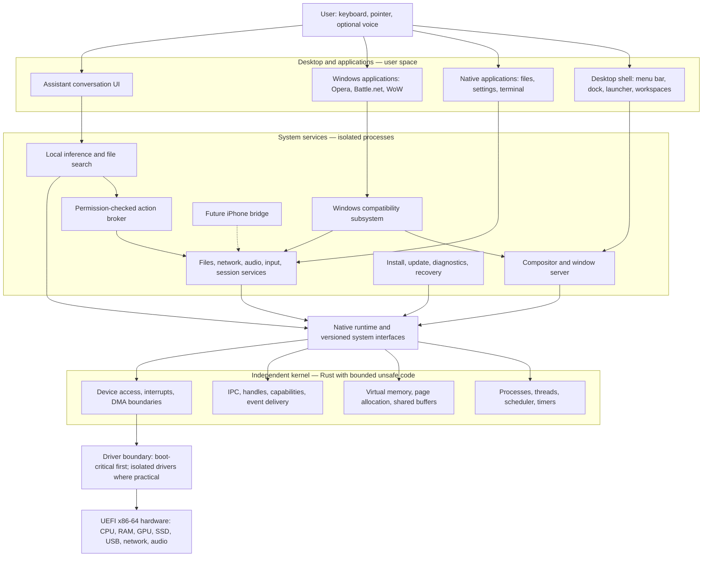
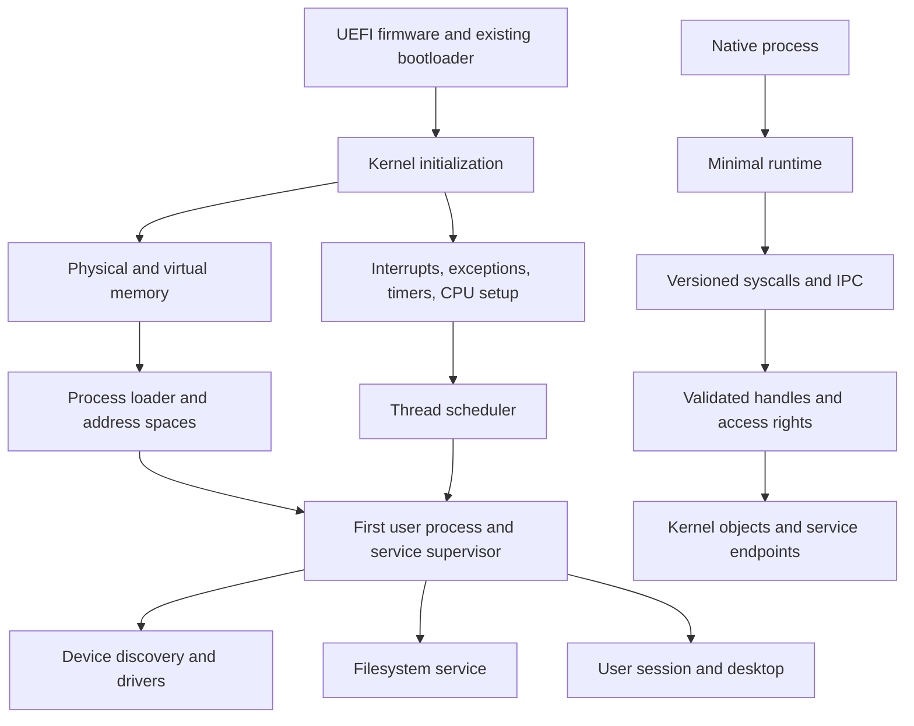
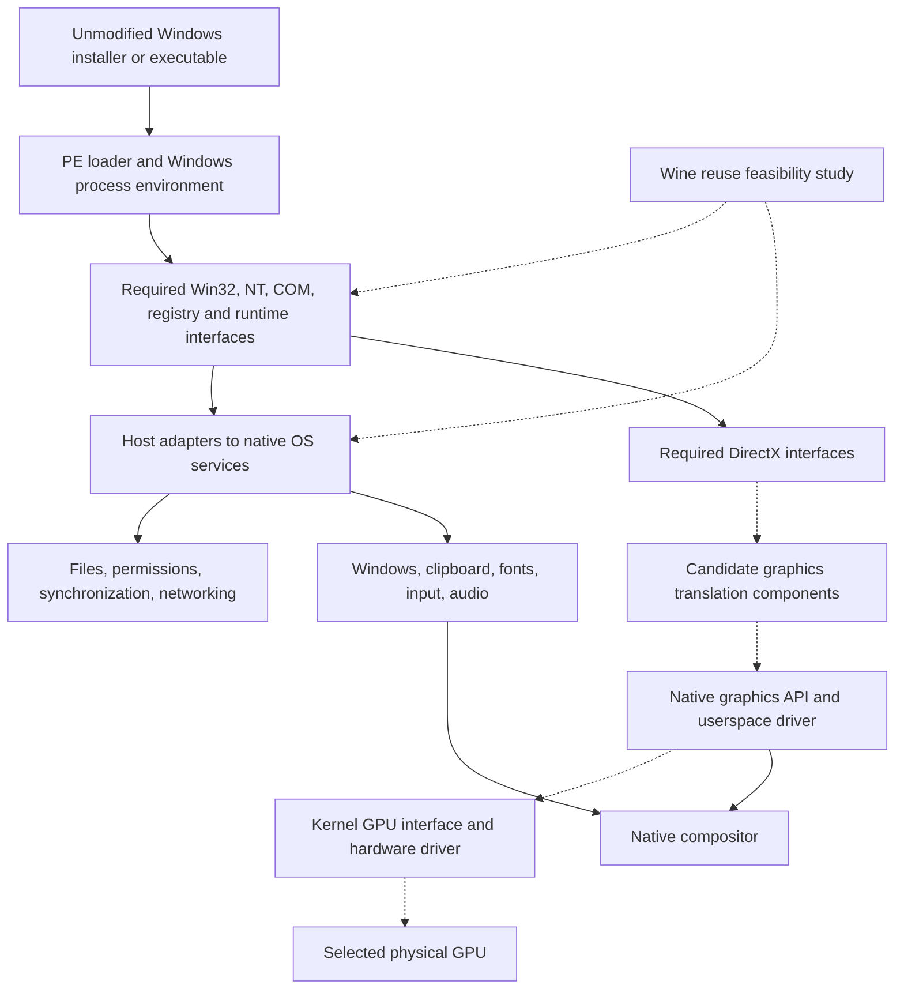
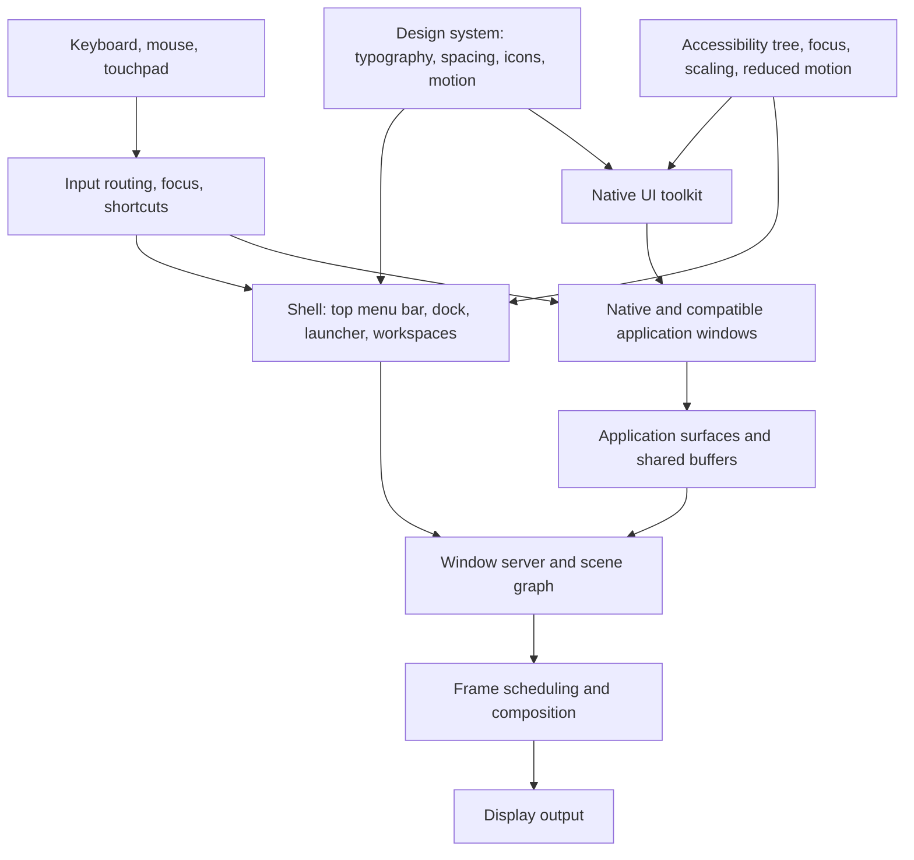
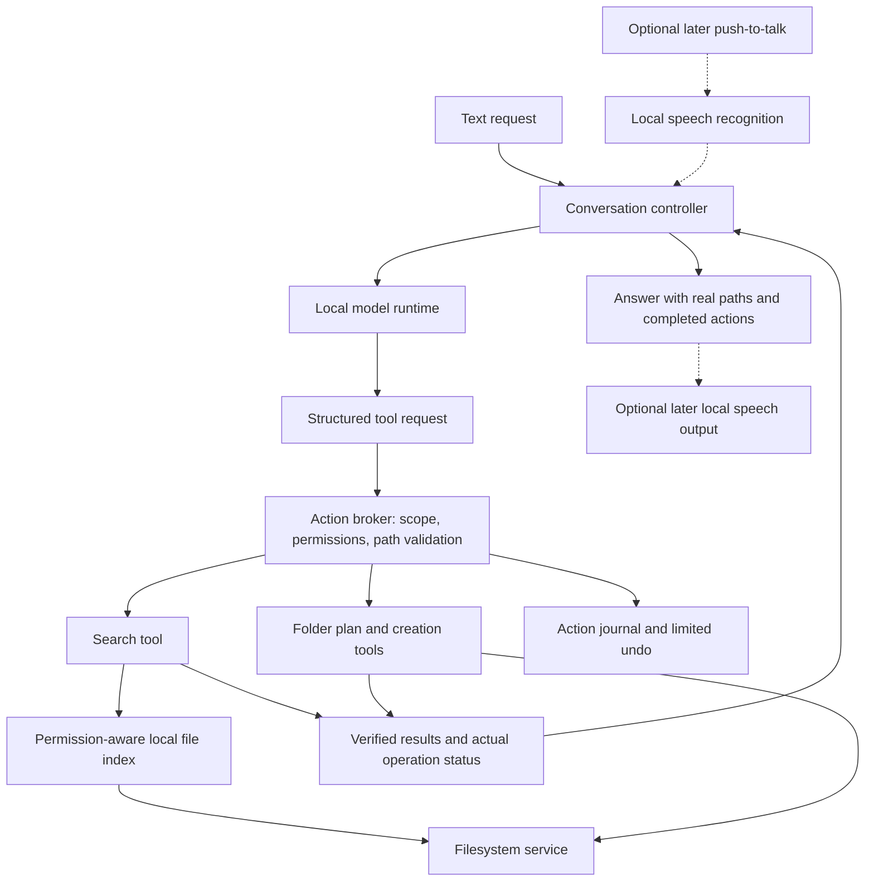
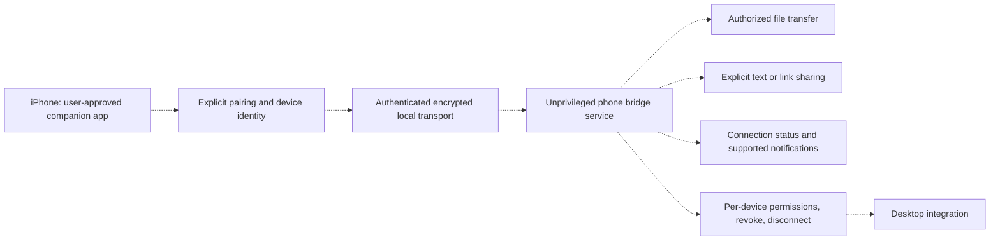
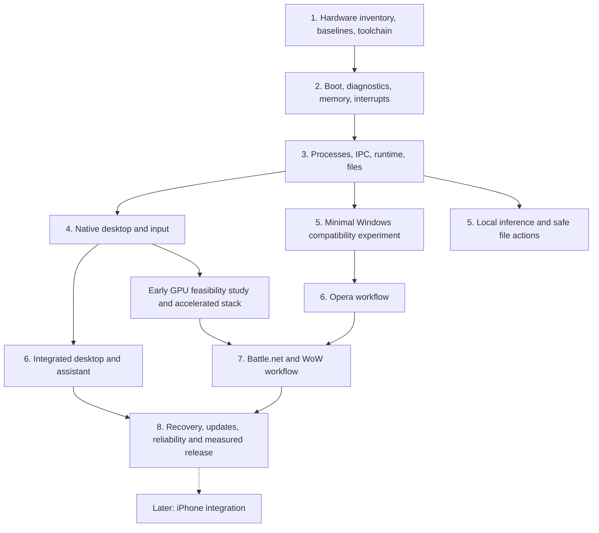

# ZooOS — architecture blueprint

Status: proposed architecture. Project name: ZooOS (formerly the placeholder OriginsOS). This is a separate project
from Stonepyre. Implemented so far (M1, M2): in the kernel diagram, "UEFI firmware
and existing bootloader", "Kernel initialization", and the single-CPU parts of
"Physical and virtual memory" and "Interrupts, exceptions, timers, CPU setup"
(see docs/m2-design.md), plus an interim kernel-mode text console with
keyboard input (docs/console-design.md), which is a diagnostic tool, not the
desktop. M3 adds the first parts of "Process loader and address spaces",
"Thread scheduler" (single-threaded processes), "First user process and
service supervisor" (Zookeeper), "Versioned syscalls and IPC", "Validated
handles" and a read-only initial filesystem (docs/m3-design.md). M4 adds a
first "Compositor and window server" (PeacockHandler: two side-by-side
windows, keyboard focus, back-buffered frames) and two native applications
(docs/m4-design.md); the scene graph, design system, toolkit and
accessibility are still proposed. Every other component is proposed.
Updated: 2026-10-30

## Product direction

An independent Rust-first OS for x86-64 PCs, with a macOS-inspired desktop,
local conversational assistance, and staged Windows application compatibility.
Neither Windows nor Linux is the kernel foundation. Existing open-source
components may be reused after technical and licensing review.

Primary application goals: install and use Opera; install Battle.net, download
and update World of Warcraft, and play it with working accelerated graphics.
These are feasibility targets, not compatibility or performance guarantees.

## System overview

Solid arrows show proposed dependencies or calls. Dashed arrows show deferred
features or unproven integration paths. All boxes are planned components.

## Kernel and native execution

Provisional kernel direction: a small pragmatic kernel with process isolation,
explicit handles, and a narrow syscall surface. Avoid committing to a pure
microkernel or large monolithic design until IPC and driver prototypes inform
latency and complexity. Place policy and recoverable services in user space
where practical; not every driver must be isolated in the first boot milestone.

Use Rust without the standard library for the early kernel; build a native
runtime as the OS matures. Use assembly only for required startup, context,
and processor operations. Reused C/C++ stays in its original language where
practical, behind audited foreign-function boundaries. Safe Rust does not
replace checking permissions, concurrency, DMA, or hardware assumptions.

Start with a read-only initial filesystem and serial diagnostics. Add writable
storage, crash consistency, and recovery before trusting personal data to it.
Select the persistent filesystem after evaluating existing portable code.

## Windows application compatibility

Wine is a possible source of compatibility code, not a ready-made port to our
kernel. It needs host facilities that must be provided or adapted. Investigate
that dependency surface before selecting a native API design solely around it.
Do not promise to support Windows kernel drivers.

Compatibility stages: console executable; simple GUI application; installer and
multi-process application; Opera; Battle.net installation/login/download/patch;
WoW launch and sustained online play. Test exact versions and complete workflows,
including restart, persistent profiles, updates, audio, and input.

GPU acceleration is a critical feasibility gate. DirectX translation still needs
an underlying graphics implementation and working GPU drivers. A framebuffer
is enough for early UI, not modern game performance. Investigate portability,
firmware, driver availability, and licensing on one reference GPU early.
Do not weaken browser sandboxing or bypass software integrity checks to pass a
compatibility milestone. Vendor updates may require renewed compatibility work.

## Desktop and visual direction

Adopt the qualities the user likes in macOS: a coherent top menu bar and dock,
consistent window controls, restrained translucent materials, clear typography,
fluid window motion, workspace gestures, fast universal search, and integrated
settings. Use original identity and assets. This document is an architecture,
not a finalized visual mockup.

Define keyboard navigation, readable contrast, display scaling, reduced motion,
and non-translucent alternatives alongside the visual system. Effects must fit
measured frame budgets. Windows applications retain their own UI unless a safe,
compatible integration mechanism exists; do not promise universal native styling.
Toolkit and graphics library selection remain open pending portability tests.

## Local assistant and file actions

Initial tools: search files, inspect a path, list a directory, preview a folder
plan, and create directories in user-authorized locations. The model does not
receive unrestricted shell access or kernel authority. File contents and names
are untrusted data, not permission to execute instructions.

Canonicalize paths and handle symlinks and filesystem races. Respect user access
rights and exclusions. Existing scoped grants can permit routine reads and
folder creation without repeated prompts. Destructive or broader actions need
appropriate authorization. Undo only removes newly created directories that
remain empty; never delete subsequently added content.

Inference runs asynchronously in a separate process with cancellation and CPU,
RAM, and eventual GPU budgets. Index incrementally and defer work under load.
Start with a small CPU-capable runtime port; model availability on another OS
is not evidence of portability. Default to local conversations and inference.
The desktop must remain usable when the model is stopped or crashes.

## Future iPhone connection

Deferred scope: prove a companion-app connection and explicit text/link or file
transfer first. Research current iOS APIs and restrictions before selecting
features or transport. Do not assume access to all messages, calls, global
notifications, background clipboard, or screen mirroring. Apple ecosystem
features are not available merely by recreating their desktop interface.
No cloud account or remote assistant access is implied by this diagram.

## Cross-cutting engineering

- Security: process address spaces, validated handles, least privilege, separate
  user sessions, explicit device access, and protected credential storage.
- Reliability: service supervision, structured logs, crash reports, recovery
  boot, and tested updates. Signing and rollback design precede distribution.
- Performance: trace scheduler, IPC, filesystem, and frame behavior. Keep index,
  inference, updates, and downloads from overwhelming interactive work.
- Delivery: reproducible builds, QEMU images, versioned interfaces, reference
  hardware tests, and third-party license records.

## Dependency gates and delivery order

Workstream numbering indicates dependency stages, not time estimates. Investigate
GPU feasibility and Wine host requirements early, before polishing the desktop.
If these fail, record the blocker and revisit scope rather than claim compatibility.

## Acceptance and performance

Record reference hardware and software versions, power mode, display refresh,
and workload. Use repeated trials and distinguish cold from warm runs. Compare
against supported Windows on the same hardware; QEMU tests validate functionality,
not final physical-machine performance. Set numeric budgets after baselines.

| Area | Evidence required |
| --- | --- |
| Core OS | Boots reproducibly; isolated processes; correct memory and IPC behavior |
| Desktop | Usable windows, focus, scaling, keyboard navigation and stable frame pacing |
| Opera | Install, browsing, profile, downloads, media, sandbox behavior and update |
| Battle.net | Install, login, download, patch, restart and launch |
| WoW | Sustained gameplay; audio/input/network; frame times, FPS and 1% lows |
| Assistant | Correct file results; authorized folder creation; cancellation and error reporting |
| Contention | Desktop/game behavior while inference, indexing and downloads run |
| Recovery | Interrupted updates and service failures have tested recovery paths |
| Future phone | Pair, transfer, permission revoke and disconnect on tested iOS versions |

## Open decisions

Trademark check for the ZooOS name; target hardware; Opera versus Opera GX; WoW edition; kernel layout;
filesystem; driver model; Windows compatibility reuse; graphics API; native UI
toolkit; model/runtime and speech stack; measurable performance budgets.

## Reference context

- Wine: https://www.winehq.org/about/
- Opera platforms: https://www.opera.com/download/requirements
- Proton reference: https://github.com/ValveSoftware/Proton
- Apple hardware/software context:
  https://developer.apple.com/videos/play/wwdc2020/10686/

External references describe existing systems, not proof that the proposed OS
can run their components. Verify current vendor APIs when implementing phone
integration and specific application workflows.

